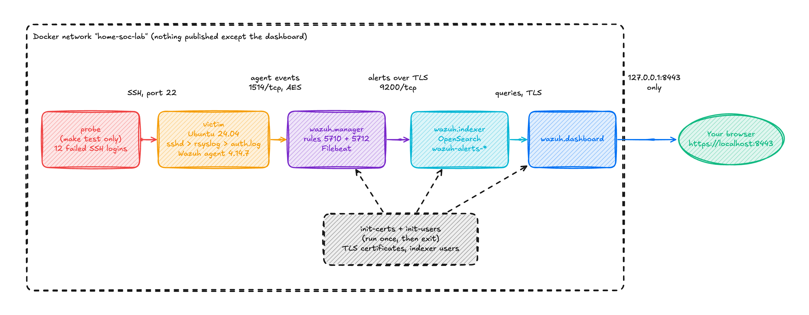

# home-soc-lab

A small security operations lab that rebuilds itself from a git clone. One command starts a
Wazuh SIEM and an Ubuntu victim that it monitors. A second command attacks the victim's SSH
login and proves that the SIEM raises the right alert. Nothing is click-built, so anyone can
reproduce it.

---

## Architecture



The diagram source is [`docs/img/architecture.excaliflow`](docs/img/architecture.excaliflow).
Open it in
[Excaliflow](https://github.com/Shubhamsaboo/awesome-llm-apps/tree/874bc13a57aa2ba1266a84f2444808ce3093efb6/advanced_llm_apps/excaliflow)
to edit it.

Events flow from left to right. sshd on the victim writes each login attempt to
`/var/log/auth.log` through rsyslog. The Wazuh agent reads that file and sends each line to the
manager over an encrypted connection. The manager decodes the line, matches it against its rules,
and writes an alert. Filebeat, inside the manager container, ships the alert over TLS to the
indexer. The dashboard reads alerts from the indexer.

Only the dashboard is reachable from outside Docker, and only from this machine.

## What runs in it

| Service | Image | Role |
|---|---|---|
| `wazuh.manager` | Wazuh 4.14.7 | Decodes events, applies rules, raises alerts |
| `wazuh.indexer` | Wazuh 4.14.7 (OpenSearch) | Stores alerts |
| `wazuh.dashboard` | Wazuh 4.14.7 | Web interface for alerts |
| `victim` | Ubuntu 24.04 + Wazuh agent 4.14.7 | The monitored host. Runs sshd and rsyslog |
| `init-certs`, `init-users` | Manager and indexer images | Run once to create TLS certificates and indexer users, then exit |
| `probe` | The victim image | Started only by `make test`. Makes failed SSH logins |

Every image is pinned by digest. Tags move; digests do not.

## Result

`make test` makes 12 failed SSH logins to the victim, as a user name that does not exist. The
lab must then show three things:

1. The manager raises rule **5710**, "sshd: Attempt to login using a non-existent user". A
   run gives 11 of these. The twelfth attempt raises rule 5712 instead.
2. The manager raises rule **5712**, "sshd: brute force trying to get access to the system",
   at level 10. Wazuh maps this rule to MITRE ATT&CK **T1110, Brute Force**.
3. The 5712 alert reaches the indexer, where the dashboard can show it.

On a 13-inch MacBook Pro (Apple M1, 8 GB) the test takes about 10 seconds. Wazuh mutes rule
5712 for 60 seconds after it fires, so a second run inside that minute waits until the minute
is over. See [Evidence](#evidence).

A test that cannot fail proves nothing, so I also ran it with rsyslog stopped on the victim. The
logins still happened, but no log line reached the agent. The test waited 120 seconds for rule
5710, then failed with exit code 1.

---

## Quickstart

**You need:**

- macOS or Linux, on `arm64` or `amd64`
- A container runtime: Colima, Docker Desktop, or Docker Engine, with Docker Compose 2.30 or
  later
- At least 4 GB of memory for the runtime. The lab uses about 2 GB when idle.
- 20 GB of free disk before the first start. The images take 4.2 GB and the running lab about
  0.5 GB more. `make up` asks for the extra room because the download needs space of its own.
- Port 8443 free on `127.0.0.1`. Set `DASHBOARD_PORT` in `.env` to use another port.

```bash
git clone https://github.com/Keniolax/home-soc-lab.git
cd home-soc-lab
make up
make test
```

`make up` checks this list before it starts anything and stops with a message if an item fails.

**On Colima,** start the VM with at least 4 GB:

```bash
colima start --cpu 4 --memory 4
```

Colima keeps Docker's data in a disk file on your Mac. The file grows as Docker writes, and it
does not give space back by itself after `make down`. To return the space to macOS, run:

```bash
colima ssh -- sudo fstrim -v /var/lib/docker
```

### What you should see

The first `make up` creates `.env` with random passwords, pulls the images and starts the lab.
It took 5 minutes on a home connection, most of it the image download. Later starts take
about 60 seconds. The command returns only when every service passes its health check, and
then prints:

```
Lab is up.
  Dashboard: https://localhost:8443
  User:      admin
  Password:  the INDEXER_ADMIN_PASSWORD line in .env
```

Your browser will warn that the certificate is not trusted. The lab signs its own certificates,
so this is expected. Accept the warning for `localhost` only.

A healthy lab shows four services as `healthy` in `make status`, and the agent `victim` as
active under **Agents** in the dashboard.

`make test` then prints:

```
PASS  agent 'victim' is active on the manager
PASS  made 12 failed SSH logins to victim as 'probe-1792453406'
PASS  manager raised rule 5710 (invalid user)
PASS  manager raised rule 5712 (SSH brute force)
      alerts for 'probe-1792453406': 11 x 5710, 1 x 5712
PASS  rule 5712 alert is in the indexer (wazuh-alerts-*)
```

### Other commands

| Command | What it does |
|---|---|
| `make status` | Shows each service and its health |
| `make logs` | Follows the logs of every service |
| `make audit LABEL=before` | Scores the victim with Lynis and the CIS checks |
| `make harden` | Hardens the victim to part of the CIS benchmark |
| `make down` | Stops the lab and deletes its containers, volumes and certificates |
| `make clean` | Also deletes `.env` and the victim image |

`make down` leaves nothing running. The next `make up` starts a fresh lab with new
certificates and the same passwords.

---

## Hardening

`make harden` raises the victim's CIS score from 48% to 70-71%, and its Lynis hardening index
from 56 to 65. The detection test still passes afterwards. The write-up,
[docs/hardening.md](docs/hardening.md), lists every change and what it taught.

---

## Security defaults

A lab is still a set of real services with real passwords, so it starts locked down.

- **No default passwords.** `make up` writes three random passwords to `.env`, with file
  mode 600. Git ignores `.env`. The indexer's demo users (`kibanaro`, `logstash` and others)
  are removed.
- **Passwords stay out of command lines.** The bcrypt hashing tool reads each password from an
  environment variable. The test sends the indexer password to `curl` on standard input.
- **One port, on localhost only.** The dashboard listens on `127.0.0.1:8443`. The manager, the
  indexer and the victim's SSH server are reachable only inside the Docker network.
- **Private TLS everywhere.** `scripts/init-certs.sh` creates a certificate authority and one
  certificate for each service, then deletes the authority's private key. Nothing can sign
  further certificates for the lab. Each container mounts only its own key, read-only.
- **Pinned supply chain.** Every image is pinned by digest. The victim installs agent
  `4.14.7-1` exactly, and its build stops if the Wazuh signing key does not have the expected
  fingerprint.
- **No password logins on the victim.** No account on the victim has a password, and root
  login over SSH is off. The test fails logins on purpose and cannot succeed at one.

## Design decisions

**Decision: Wazuh is pinned to 4.14.7 by digest.**
*Alternatives considered:* the Elastic Stack; plain OpenSearch; a floating `latest` tag.
*Why:* Wazuh ships its own agent, decoders and rule set, so the lab reaches real detections
sooner. The version matters more than usual here. Wazuh 4.14.7 publishes `arm64` images, but
4.10.4 is `amd64` only. An unpinned tag could break the lab on Apple Silicon without warning.
*Cost accepted:* Wazuh needs more memory than a bare log store.

**Decision: `make up` wraps the compose command.**
*Alternatives considered:* telling people to run `docker compose up` and a setup step by hand.
*Why:* the promise is one command. A README that hides a second step is not reproducible. It is
only untested.
*Cost accepted:* one more tool to install, though `make` ships with macOS and most Linux.

**Decision: the lab makes its own certificates instead of using Wazuh's generator image.**
*Alternatives considered:* `wazuh/wazuh-certs-generator`, the method in Wazuh's own Docker
guide.
*Why:* that image downloads its certificate script from the internet each time it runs, with no
checksum, so a pinned digest does not pin what runs. Its output also failed on a macOS bind
mount. A 74-line OpenSSL script in this repo runs inside the pinned manager image instead, and
anyone can read what it does.
*Cost accepted:* I maintain the script. If Wazuh changes what its services expect from a
certificate, the lab breaks until I update it.

**Decision: the test uses a one-shot client, not an attacker host.**
*Alternatives considered:* a Kali Linux container running Hydra.
*Why:* the test has to prove one thing, that a failed-login pattern reaches an alert. Twelve
`ssh` calls do that in about 10 seconds, from the image the lab already builds. An attacker
host would add another image and another set of tools to keep up to date, for the same result.
*Cost accepted:* the lab does not yet show what an attacker's tools look like in the logs.

**Decision: vulnerability detection is off.**
*Alternatives considered:* Wazuh's default, which turns it on.
*Why:* on first start the manager unpacks a vulnerability database, which ships inside its
image, into `/var/ossec/queue/vd`. The result is 8.3 GB, written in 72 seconds. That filled the
disk of the Mac that built the lab, twice. The detection this lab tests does not use the
database. `scripts/manager-config.sh` turns it off before Wazuh first starts. It must run
before the image's own `2-manager` script, which starts Wazuh briefly to set the API password.
*Cost accepted:* the dashboard's vulnerability pages stay empty. To turn detection back on,
remove that `sed` line and allow about 9 GB more disk.

**Decision: the victim runs rsyslog in classic format.**
*Alternatives considered:* sshd's `-E` option to write its own log file; rsyslog's default
format on Ubuntu 24.04.
*Why:* Wazuh's sshd decoder expects a syslog header with the program name. `sshd -E` writes
lines with no header. The classic `Oct 19 23:43:31 victim sshd[1340]:` format is the one every
Wazuh decoder accepts.
*Cost accepted:* a third process in the victim container.

## What I chose not to build

- **No Vagrant.** Containers start faster and need less memory. The lab does not need full
  virtual machines.
- **No live Windows host.** x86 Windows will not run on Apple Silicon.
- **No extra services.** This project is graded on whether a stranger can rebuild it, not on
  how large it is.

## Limitations

- **One detection.** The lab tests one rule chain: SSH logins as users that do not exist. It
  does not test logins as real users, other services, or file integrity alerts.
- **No attacker host.** The probe only proves that the detection works. It is not a red-team
  tool.
- **No Windows telemetry.** Windows detections are not covered yet.
- **No vulnerability detection.** It is off to save disk. See the design decisions above.
- **Single node.** One manager and one indexer, with no high availability. If the indexer
  stops, the dashboard shows nothing until it returns.
- **Open agent enrollment.** Any container on the lab network can enroll as an agent without a
  password. Only containers that Compose starts can reach that network.
- **Passwords apply only to a fresh lab.** The indexer reads its user list once, when it first
  creates its security index. To change a password, run `make down`, edit `.env`, then
  `make up`.
- **Shared agent settings need a restart.** The agent does not restart when the manager sends
  it new shared configuration, because that restart made the test lose log lines. If you add
  settings to the manager's `default` agent group, run `docker compose restart victim`.
- **Tested on Apple Silicon only.** The images and the agent package exist for `amd64`, but I
  have not run the lab on an `amd64` machine.

## Evidence

The rule 5712 alert from a test run, as the manager wrote it. The full file is
[`docs/evidence/5712-alert.json`](docs/evidence/5712-alert.json).

```json
{
  "timestamp": "2026-10-20T00:24:46.077+0000",
  "rule": {
    "level": 10,
    "description": "sshd: brute force trying to get access to the system. Non existent user.",
    "id": "5712",
    "mitre": {
      "id": [
        "T1110"
      ],
      "tactic": [
        "Credential Access"
      ],
      "technique": [
        "Brute Force"
      ]
    },
    "frequency": 8
  },
  "agent": {
    "id": "001",
    "name": "victim",
    "ip": "172.18.0.4"
  },
  "decoder": {
    "parent": "sshd",
    "name": "sshd"
  },
  "data": {
    "srcip": "172.18.0.6",
    "srcport": "50802",
    "srcuser": "probe-1792455831"
  },
  "location": "/var/log/auth.log",
  "full_log": "Oct 20 00:24:44 victim sshd[2335]: Invalid user probe-1792455831 from 172.18.0.6 port 50802"
}
```

The test output from the same run is in
[`docs/evidence/make-test.txt`](docs/evidence/make-test.txt).

---

## License

MIT. See [LICENSE](LICENSE).
