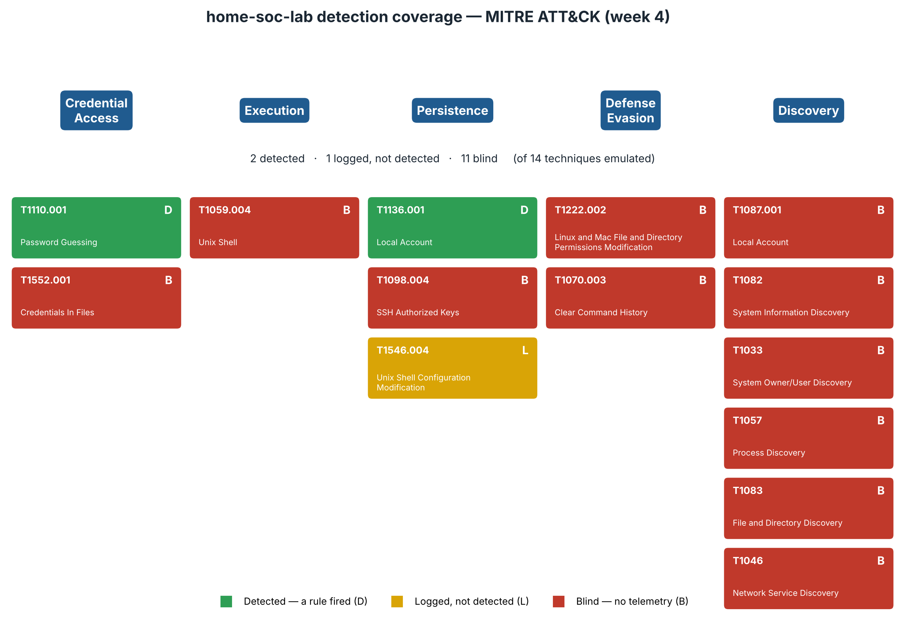

# Detection coverage (week 4)

This measures what the lab's SIEM can actually catch. Seeing a log is not the
same as having a rule that fires on it, so each technique gets one of three
verdicts, not a yes or no.

`make coverage` runs 14 real [Atomic Red Team](https://github.com/redcanaryco/atomic-red-team)
techniques on the victim, one at a time, then reads what Wazuh did with each:

- **Detected** — a Wazuh rule fired.
- **Logged** — a sensor on the host recorded the behaviour, but no rule fired.
- **Blind** — nothing on the host saw it at all.



The atomics are pinned to one commit, and the runner checks every command
against that commit before it runs anything, so the emulated behaviour is the
real published atomic, not an approximation. The full run evidence is in
[`evidence/coverage/`](evidence/coverage/).

## Result

| Verdict | Count | Techniques |
|---|---|---|
| 🟢 Detected | 2 | SSH brute force (T1110.001), create local account (T1136.001) |
| 🟡 Logged, not detected | 1 | Write to a shell profile (T1546.004) |
| 🔴 Blind | 11 | all six discovery atomics, Unix shell execution, SSH authorized-keys persistence, chmod, history wiping, credential search |

The two detections are the ones the lab was built for: the brute force chain
from week 1, and account creation, which `useradd` writes to the system log.
Every blind technique sent the SIEM **zero events**, not just zero alerts. The
full matrix with the exact rule IDs is in
[`evidence/coverage/matrix.md`](evidence/coverage/matrix.md).

## The three blind spots

**1. No record of commands.** The victim has no process or `execve` auditing,
and Wazuh's Linux rules read log lines. Nine techniques ran and left no trace:
every discovery atomic (T1087.001, T1082, T1033, T1057, T1083, T1046), the
Unix-shell execution (T1059.004), the credential search (T1552.001), and the
`chmod` (T1222.002). The whole Execution tactic and most of Discovery are
invisible. *Fix:* add `auditd` with `execve` rules, or Wazuh command
monitoring, so the SIEM sees what runs. Week 5 writes the detections.

**2. No network sensor.** The port scan (T1046) opened connections to a lab
container and nothing saw them. The SIEM reads host logs only; there is no
Zeek, Suricata, or flow data. The same gap hides command-and-control and data
theft. *Fix:* add network detection. Week 6 does this.

**3. File watching is late and narrow.** The agent's file-integrity monitor
covers `/etc`, `/bin`, `/usr/bin`, `/usr/sbin`, `/sbin`, and `/boot`, but only
on a 12-hour scan. The shell-profile write (T1546.004) lands in `/etc`, so a
scan will catch it later, but no alert fires at the time. Persistence outside
those paths is never caught: a foreign key in `~/.ssh/authorized_keys`
(T1098.004) and history wiping in `~/.bash_history` (T1070.003) both went by.
*Fix:* turn on real-time FIM, widen the scope to `~/.ssh`, and add rules for
authorized-key and history changes.

## Reproduce

```bash
make up
make coverage
```

The run takes about five minutes. It turns on full event archiving so it can
see every event the SIEM receives, then sets it back. Results land in
`coverage/navigator/coverage-layer.json` (import it into the
[ATT&CK Navigator](https://mitre-attack.github.io/attack-navigator/)) and in
`docs/evidence/coverage/`.

## Limits

- **14 techniques, not the whole matrix.** The set spans five tactics and mixes
  techniques the lab catches with ones it misses. It is a sample, not a census.
- **One host, Linux only.** The lab has no Windows telemetry, so Windows
  techniques are not tested.
- **Time-window attribution.** The scorer ties an alert to a technique by its
  MITRE id and the run window. Two techniques with the same base id would need
  tighter handling; none in this set share one.
